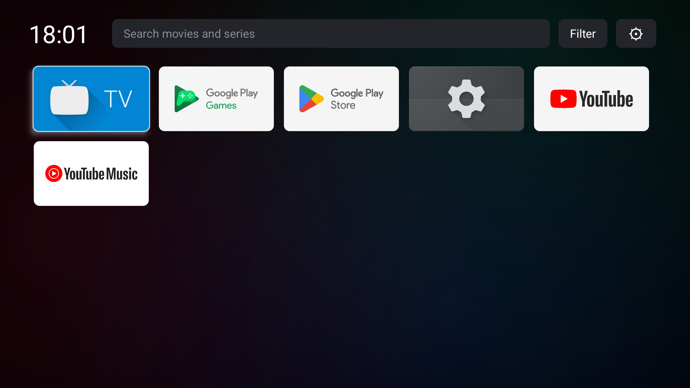
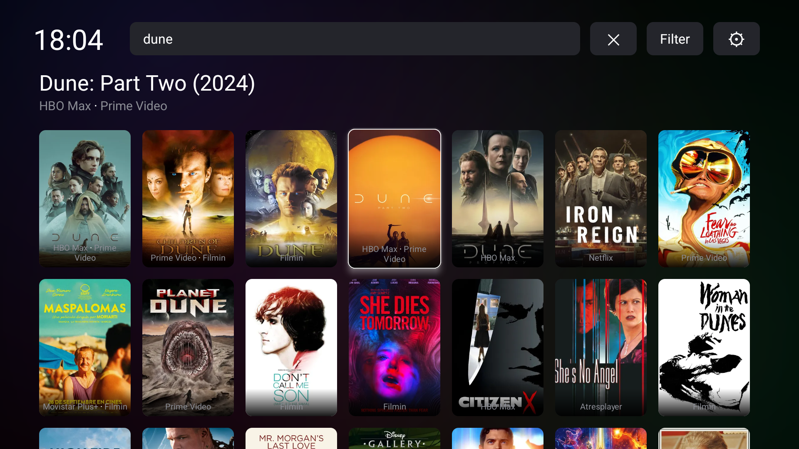
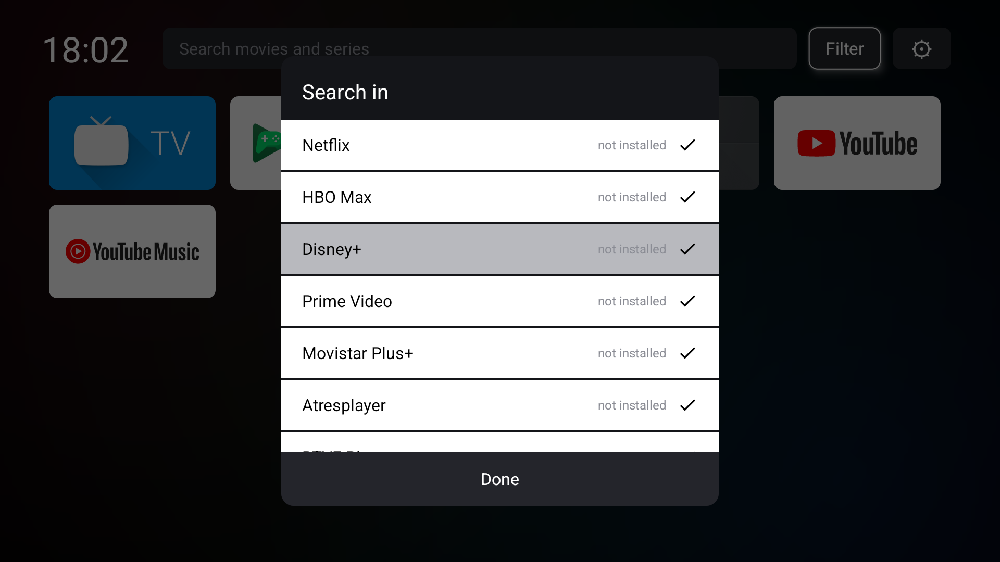

# Light Launcher

A small, fast home screen for Android TV / Google TV, with no ads, no recommendations feed and
no tracking. It only asks for the internet permission.



| Search | Filter |
|---|---|
|  |  |

- **Your apps**, most recently used first, then alphabetical.
- **Title search** across the streaming services you pay for (via JustWatch), showing only titles
  included in your subscriptions. Picking a result opens it directly in the right app; if more than
  one service has it, you choose. Services whose app isn't installed are greyed out and lead to the
  Play Store.
- **Filter** to choose which services the search covers.
- **Continue watching**: the last 10 titles played in any app, from the TV's "now playing"
  information (needs notification access, see below).
- Dark moving background, frosted top bar. About 75 KB.

Supported services: Netflix, HBO Max, Disney+, Prime Video, Movistar Plus+, Atresplayer, RTVE Play,
Crunchyroll, Apple TV, Filmin, SkyShowtime and MUBI.

> The search is set up for **Spain** (country `ES`, Spanish titles). See
> [Other countries and languages](#other-countries-and-languages) to change it.

## Requirements

- Android TV / Google TV on Android 13 (API 33) or newer
- To build: JDK 17+ (Android Studio's bundled one works) and the Android SDK

## Build

```bash
./gradlew assembleRelease
```

The APK is in `app/build/outputs/apk/release/`. Without a release key it is signed with your
debug key, which is fine for installing on your own TV.

### Signing with your own key

Copy `keystore.properties.example` to `keystore.properties` and fill it in. Both that file and
any keystore are git-ignored; keep the keystore outside the project and back it up. Updates only
install over an existing copy when they're signed with the same key.

## Install

Turn on developer options and **Wireless debugging** on the TV, then from a PC:

```bash
adb pair <tv-ip>:<pairing-port>
adb connect <tv-ip>:<port>
adb install -r app-release.apk
```

### Continue watching

Allow the launcher to read what's playing:

```bash
adb shell cmd notification allow_listener com.lwphs.tvlauncher/com.lwphs.tvlauncher.WatchTracker
```

Not every app shares what it's playing. Movistar Plus+ shares nothing; Prime Video only shares
an ID, so the title is read from its public web page.

### Making it the home screen

Pressing Home on Google TV always goes to Google's own launcher, because system launchers outrank
any installed one. The only way around it is disabling Google's launcher and setup app
(`com.google.android.apps.tv.launcherx`, `com.google.android.tungsten.setupwraith`) with
`adb shell pm disable-user --user 0 <package>`.

**This is at your own risk.** On some TVs it removes Wi-Fi networks that were set up through the
setup app (you'll have to reconnect), and if the launcher is uninstalled with nothing else
enabled, the TV has no home screen. Undo it with `adb shell pm enable --user 0 <package>` for
both packages.

## Other countries and languages

Everything that depends on the country or language, all in `app/src/main/`:

| What | Where | Spain setting | Change it to |
|---|---|---|---|
| Search country | `JustWatch.java`, `COUNTRY` | `"ES"` | Your two-letter country code: `"US"`, `"GB"`, `"MX"`… Decides which catalogue and services are searched. |
| Search language | `JustWatch.java`, `LANGUAGE` | `"es"` | `"en"`, `"fr"`… Decides the language of titles **and posters**. |
| Services | `JustWatch.java`, `SERVICES` | 12 services | The services sold in your country (see below). |
| Prime Video titles in Continue watching | `PrimeVideo.java`, the `/-/es/` in the page address and `Accept-Language` `es-ES` | Spanish | Your language, e.g. `/-/en/` and `en-US`. |
| Filmin | `Filmin.java`, `MainActivity.java` (`FILMIN_TV_LINK`) | `filmin.es`, `/es` | Filmin is Spain-only; elsewhere, remove it from `SERVICES`. Its code then never runs. |
| Interface text | `res/values/values.xml` | English | Add a translation (see below). |

App sorting follows the TV's language by itself.

### Services for your country

Each entry in `SERVICES` is the service's JustWatch code, its Android TV app package and the name
shown. **JustWatch codes differ between countries**: Prime Video is `prv` in Spain but `amp` in
the US. List the codes for your country (here the US):

```bash
curl -s https://apis.justwatch.com/graphql -H "Content-Type: application/json" -d "{\"query\":\"{ packages(country: US, platform: WEB) { shortName clearName } }\"}"
```

Find an app's package name on the TV with `adb shell pm list packages`, or in its Play Store
address (`...details?id=<package>`). Use the **TV** app's package, which is sometimes different
from the phone app's (Filmin's TV app is `com.filmin.androidtv`, its phone app `com.filmin.filmin`).

Spain-only services in the current list: Movistar Plus+, Atresplayer, RTVE Play and Filmin.
SkyShowtime is only in some European countries.

### Translating the interface

Copy the `<string>` lines from `res/values/values.xml` into a new
`res/values-<language>/strings.xml` (for example `values-es/strings.xml`) and translate the text
between the tags, keeping the `name`s and the `%1$s` / `%1$d` placeholders. The TV picks the
translation that matches its language.

## How it works and caveats

- Search uses JustWatch's **unofficial** GraphQL API (the one justwatch.com uses). It can change
  or stop working at any time, and its terms may not allow this use. This project isn't
  affiliated with JustWatch or any streaming service.
- Prime Video titles in Continue watching come from Prime Video's public title pages, and Filmin
  links from Filmin's public pages, because their TV apps don't share titles or accept web links.
- Network access is limited to these services, with size limits and a fixed list of image servers
  (`Net.java`).
- Watch history and the service filter stay on the TV; nothing is sent anywhere else.

## License

[MIT](LICENSE)
